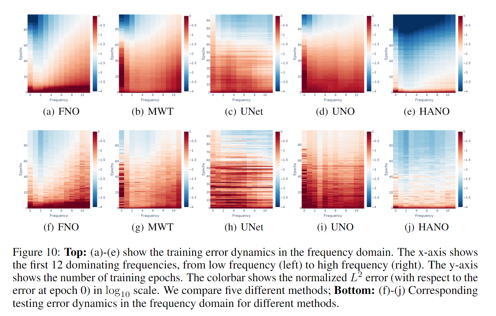
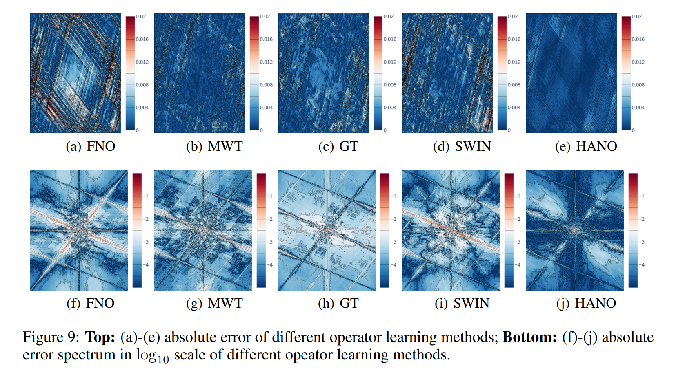
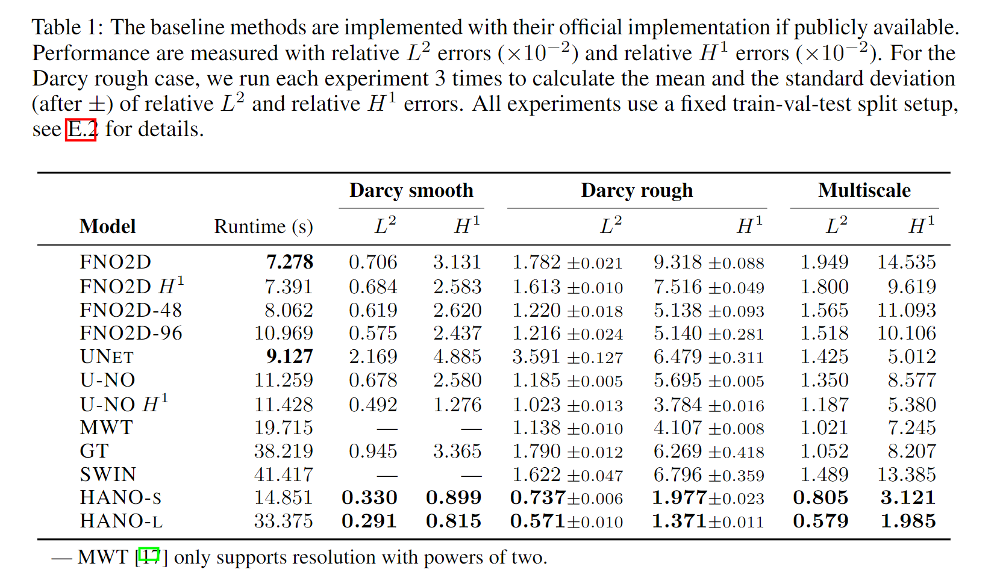

# HANO — Hierarchical Attention Neural Operator

<p align="center">
  <b>Mitigating spectral bias for the multiscale operator learning</b><br>
  <a href="https://arxiv.org/abs/2210.10890">📄 arXiv preprint</a> •
  <a href="https://doi.org/10.1016/j.jcp.2024.112944">📘 Journal of Computational Physics (2024)</a> •
  <a href="https://drive.google.com/drive/folders/1UnbQh2WWc6knEHbLn-ZaXrKUZhp7pjt-">📦 External dataset folder</a>
</p>

<p align="center">
  
  
</p>

The HANO paper studies spectral bias in multiscale operator learning. Its abstract describes hierarchical attention with scale-adaptive interactions and an empirical H¹ loss. This repository's active implementation is a later multigrid-attention model; it should not be confused with the published paper or the legacy model below.

## Published paper

**Mitigating spectral bias for the multiscale operator learning**

Xinliang Liu, Bo Xu, Shuhao Cao, and Lei Zhang. *Journal of Computational Physics*, 506 (2024), 112944. [DOI](https://doi.org/10.1016/j.jcp.2024.112944) · [arXiv:2210.10890](https://arxiv.org/abs/2210.10890)

```bibtex
@article{liu2024mitigating,
  title   = {Mitigating spectral bias for the multiscale operator learning},
  author  = {Liu, Xinliang and Xu, Bo and Cao, Shuhao and Zhang, Lei},
  journal = {Journal of Computational Physics},
  volume  = {506},
  pages   = {112944},
  year    = {2024},
  doi     = {10.1016/j.jcp.2024.112944}
}
```

## Implementations in this repository

The active `HANO2d` in `hano/models/hano.py` uses a convolutional patch embedding, multigrid attention blocks, and an output projection. Each block applies local attention while restricting features to coarser grids, then reconstructs finer features with transposed convolutions and skip connections.

```text
Input field
    │
Conv2d patch embedding
    │
Multigrid attention blocks
    ├─ Local attention and restriction to coarser grids
    └─ Transposed-convolution upsampling with skip connections
    │
Conv2d output projection
    │
Output field
```

`hano/models/hano_legacy.py` separately retains the earlier hierarchical window-attention encoder and FNO-style spectral decoder. This code snapshot is distinct from the active multigrid implementation; this README does not claim either snapshot exactly reproduces the published paper.

The static figures below are included in the repository. The spectral-bias notebook and its precomputed data are in `spectral_bias/`.







---

## Repository Structure

```
HANO/
├── hano/                  # Core Python package
│   ├── models/            # Active multigrid HANO/FNO models and legacy HANO model
│   ├── losses.py          # H¹ (Sobolev) loss and Lp loss
│   ├── data.py            # Dataset loaders and normalizers
│   ├── trainer.py         # Training & evaluation loops
│   └── utils.py           # Logging helpers
├── experiments/           # Experiment entry-point scripts
├── scripts/               # train.py / eval.py CLI wrappers
├── spectral_bias/         # Spectral bias analysis notebook & data
├── environment.yml
└── requirements.txt
```

---

## Installation

### pip
```bash
git clone https://github.com/xlliu2017/HANO.git
cd HANO
pip install -r requirements.txt
```

### Conda
```bash
conda env create -f environment.yml
conda activate hano
```

The dependency files pin versions; consult them for the exact environment.

---

## Datasets

The experiment scripts expect the following MATLAB files under `./data/`. They are not included in this repository. The external Drive links are listed in the repository but their contents are not validated here.

| Experiment | Files | Download |
|---|---|---|
| Darcy smooth | `piececonst_r421_N1024_smooth1.mat`, `piececonst_r421_N1024_smooth2.mat` | [Google Drive](https://drive.google.com/drive/folders/1UnbQh2WWc6knEHbLn-ZaXrKUZhp7pjt-?usp=sharing) |
| Darcy rough | `darcy_rough_train.mat`, `darcy_rough_val.mat`, `darcy_rough_test.mat` | [Google Drive](https://drive.google.com/drive/folders/1ovfK0CV6n_UUqt4tAtaxo_-9nRshhZC7?usp=sharing) |
| Multiscale trig. coeff. | `mul_tri_{train,val,test}.mat` | [Google Drive](https://drive.google.com/drive/folders/1ovfK0CV6n_UUqt4tAtaxo_-9nRshhZC7?usp=sharing) |
| Navier–Stokes | `NavierStokes_V1e-5_N1200_T20.mat` | [Google Drive](https://drive.google.com/drive/folders/1UnbQh2WWc6knEHbLn-ZaXrKUZhp7pjt-?usp=sharing) |

---

## Checkpoints

No pretrained checkpoints are tracked in this repository. The experiment scripts save model weights under `./models/`; evaluation requires a compatible checkpoint there.

---

## Training

The experiment scripts use the active multigrid-attention model for HANO runs. Run a script from the repository root after placing its input data in `./data/`:

```bash
# Darcy smooth  (res = 211)
python experiments/ex_darcysmooth.py

# Darcy rough   (res = 256)
python experiments/ex_darcyrough.py

# Multiscale trigonometric coefficient  (res = 256)
python experiments/ex_multiscale.py

# Navier–Stokes
python experiments/ex_ns.py

# FNO baseline on multiscale
python experiments/ex_fno_multiscale.py
```

Model weights and result pickles are saved under `./models/`.

---

## Evaluation

```bash
python scripts/eval.py
```

Results are written to `./results/` as `.mat` files that can be loaded with MATLAB or `scipy.io.loadmat`.

---

## Spectral Bias Analysis

The notebook uses the precomputed dynamics data included alongside it:

```
spectral_bias/spectral_bias_dynamics.ipynb
```

Precomputed dynamics data (`.npz`) for FNO, HANO, MWT, and UNO are included.

---

## License

This project is licensed under the [MIT License](LICENSE.txt).
